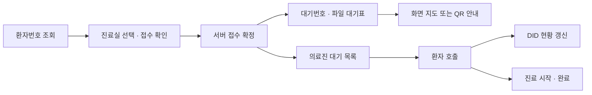
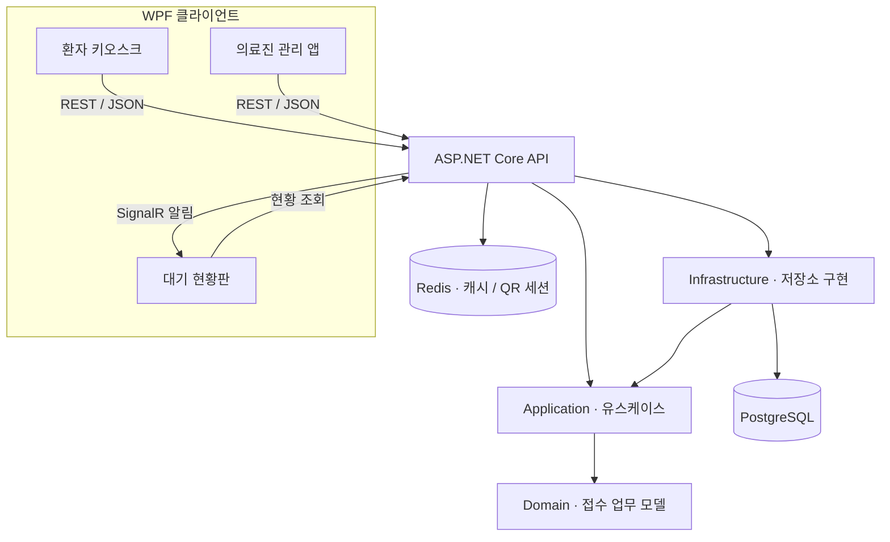

<div align="center">

# 🏥 MEDI-WAY

**접수부터 호출, 진료실 길 안내까지 연결하는 스마트 병원 키오스크**

환자용 키오스크 · 의료진 관리 앱 · 실시간 대기 현황판을 연결하는 Windows WPF 프로젝트


[주요 기능](#-주요-기능) · [설계 구조](#-설계-구조) · [실행 방법](#-실행-방법) · [검증](#-검증)

</div>

---

## 📌 프로젝트 소개

MEDI-WAY는 C#과 WPF로 구현한 병원 접수·호출·공간 안내 시스템입니다. 환자가 키오스크에서 접수하면 대기번호와 파일 대기표를 발급하고, 의료진의 호출·진료 상태를 대기 현황판에 반영합니다. 진료실까지의 경로는 서버에서 A*로 계산하며, 층이 다른 경우 엘리베이터를 거치는 지도를 나누어 보여줍니다.

WPF 클라이언트 3종과 ASP.NET Core 서버를 분리하고, PostgreSQL을 업무 데이터의 기준 저장소로, Redis를 대기열 캐시와 만료되는 모바일 안내 세션 저장소로 사용합니다.

> **시연 범위:** 가상 환자를 사용하는 포트폴리오 프로젝트입니다. 실제 병원 EMR 연동과 운영용 인증·권한·TLS 구성은 포함하지 않습니다. 대기표는 프린터 연결 없이 컴퓨터에 TXT 파일로 저장합니다.

## ✨ 주요 기능

| 영역 | 구현 내용 |
| --- | --- |
| 🖥️ 환자 키오스크 | 환자번호 조회, 이름 마스킹, 진료실 선택, 접수 및 대기번호 발급 |
| 🧾 파일 대기표 | 접수 확정 후 자동 저장, 수동 재저장, 저장 실패 시 재시도 |
| 🗺️ 병원 길 안내 | WPF 벡터 지도, 경로 그리기 애니메이션, 확대·축소, 층별 지도 전환 |
| 🏢 두 층 구성 | 1층 내과 1·2진료실, 2층 외과 3·4진료실, 엘리베이터 이동 경로 |
| 📺 대기 현황판 | SignalR 알림과 주기 조회, 층별 두 진료실을 10초마다 교대 표시 |
| 🩺 의료진 앱 | 호출·진료 시작·완료·취소, 마우스 드래그 및 버튼으로 대기 순서 변경 |
| ♿ 접근성 | 큰 글씨·고대비 모드, 확대된 터치 영역, 접근성 이름과 화면 전환 스크롤 처리 |
| 📱 모바일 안내 | QR 발급, Redis의 12시간 토큰 세션, 모바일 웹에서 층별 경로 표시 |
| 📡 접수 복구 | 확인되지 않은 요청을 로컬 JSON에 보관하고 같은 요청 ID로 재확인 |
| 🔎 연결 상태 | 실제 PostgreSQL·Redis 상태 확인, Redis 장애 시 대기열 DB 조회 대체 |

바코드는 디코딩된 텍스트와 Enter를 받는 입력 방식 및 가상 입력을 제공합니다. 실제 카메라 인식과 USB 스캐너 장치 검증은 포함하지 않습니다.

## 🔄 이용 흐름



### 접수와 대기번호 규칙

- **병원 전체에서 하루에 하나의 진행 중 접수:** 같은 환자에게 `Waiting`·`Called`·`InService` 접수가 있으면, 다른 진료과를 선택해도 기존 번호와 진료실을 반환합니다.
- **진료과별·날짜별 번호:** 내과 1·2진료실은 번호를 공유하고, 외과 3·4진료실은 별도로 공유합니다. 한국 시간 기준 다음 날 첫 접수는 1번입니다.
- **중복 요청 방지:** 응답이 유실돼도 같은 요청 ID를 재사용합니다. 동일 요청 ID에 다른 입력을 넣으면 충돌로 거절합니다.
- **상태 전이 검증:** 대기 → 호출 → 진료 중 → 완료 순서로 진행합니다. 취소는 대기·호출 상태에서만 가능합니다.
- **기록 보존:** 날짜가 바뀌어도 기존 기록을 삭제하거나 자동 완료하지 않습니다. 전날 호출·진료 중인 접수는 현재 환자로 계속 조회됩니다.

## 🧰 기술 구성

| 구분 | 기술 |
| --- | --- |
| 언어 / 실행 환경 | C#, .NET 10, Windows |
| UI | WPF, XAML, Canvas / Path, 애니메이션 |
| 클라이언트 설계 | MVVM, 데이터 바인딩, ICommand, 서비스 인터페이스 |
| 서버 | ASP.NET Core Minimal API, REST / JSON |
| 실시간 알림 | ASP.NET Core SignalR |
| 업무 데이터 | PostgreSQL 17, Npgsql, 트랜잭션·잠금·고유 인덱스 |
| 캐시 / 세션 | Redis 7.4, StackExchange.Redis |
| 경로 계산 | 서버 A*, 노드·링크·층간 연결 모델 |
| QR / 음성 | QRCoder, Windows System.Speech |
| 로컬 저장 | JSON 미확정 요청, TXT 대기표 |
| 개발 인프라 | Docker Compose |

지도는 PostgreSQL의 노드·링크·좌표 데이터로 관리합니다. 현재 구현은 PostGIS 공간 연산을 사용하지 않습니다. 패키지 버전은 각 프로젝트의 `.csproj`에서 확인할 수 있습니다.

## 🏗️ 설계 구조



### MVVM — WPF 3종

XAML View는 데이터 바인딩과 명령을 사용하고, `KioskViewModel`·`StaffViewModel`·`DisplayViewModel`은 화면 상태와 처리 흐름을 관리합니다. HTTP·파일·음성 등의 서비스는 인터페이스로 분리해 테스트에서 교체할 수 있습니다.

포커스, 드래그 좌표, 지도 렌더링, 창 수명과 스크롤 같은 View 동작은 코드 비하인드나 View 전용 Behavior에서 처리합니다.

### DDD — 접수·진료 진행 핵심 영역

| 계층 | 역할 | 주요 구현 |
| --- | --- | --- |
| Domain | 업무 규칙과 상태 | `Visit` 집합체, `PatientDay` 값 객체, `RegistrationPolicy`, `VisitStatusChanged` |
| Application | 유스케이스 조율 | `RegisterVisitService`, `TransitionVisitService`, 저장소·알림 인터페이스 |
| Infrastructure | 데이터 저장과 동시성 | PostgreSQL 저장소 구현, 트랜잭션, 진료실·환자/일자 잠금 |
| API | HTTP 경계와 연결 구성 | 요청·응답 DTO 변환, DI, 캐시·실시간 알림 어댑터 |

`Visit`이 호출·진료 시작·완료·취소 규칙을 소유하며, 상태와 버전을 외부에서 직접 수정하지 않습니다. 여러 접수 사이의 중복 방지와 진료실 점유는 도메인 규칙에 DB 제약·잠금을 함께 적용해 처리합니다.

Domain은 HTTP·WPF·Npgsql·Redis에 의존하지 않고, Application은 Domain만 참조합니다. **DDD 적용 범위는 신규 접수와 진료 상태 변경 중심**입니다. 조회·대기 순서 재정렬·지도·QR까지 모두 같은 구조로 재작성한 것은 아닙니다.

## 💡 구현 포인트

- **Redis의 책임 구분:** 대기열은 5초 캐시이며 변경 커밋 후 무효화합니다. QR 토큰은 12시간 유지합니다. 접수의 원본은 PostgreSQL에 있습니다.
- **동시 접수와 연타 대응:** UI 명령 실행 제한, 요청 이력, 환자/날짜 잠금과 병원 전체 활성 접수 고유 인덱스를 함께 사용합니다.
- **화면 간 충돌 감지:** 상태 변경과 대기 순서 변경에 버전을 사용해 오래된 화면의 요청을 거절합니다.
- **층간 A* 경로:** 폐쇄 링크를 제외하고, 연결된 엘리베이터와 각 층 경로를 계산해 지도 구간을 제공합니다.
- **실패 후 같은 요청 재확인:** 로컬에 저장한 미확정 요청은 서버 응답을 확인한 뒤 정리합니다. 임의 대기번호를 만들지 않습니다.
- **종료 수명 관리:** 타이머·이벤트·백그라운드 작업·SignalR 연결을 정리하고, 반복 종료 후 작업 중지와 객체 수거를 검증합니다.

오프라인 복구는 **환자 조회와 진료실 선택을 마친 미확정 요청 1건**을 대상으로 합니다. 서버에 처음부터 연결할 수 없는 상태의 환자 조회나 다수 환자의 오프라인 접수는 지원하지 않습니다.

## 🚀 실행 방법

### 준비 환경

- Windows와 .NET 10 SDK — `global.json` 기준 SDK `10.0.402`, 동일 기능 밴드의 최신 패치 허용
- Docker Desktop의 Linux 컨테이너 엔진과 Docker Compose
- Windows PowerShell 5.1 또는 PowerShell 7
- IDE 사용 시 .NET 10과 WPF를 지원하는 개발 환경
- 음성 사용 시 Windows 한국어 TTS 음성과 오디오 출력 장치

### 1. 소스 가져오기

```powershell
git clone https://github.com/baeseojin/MEDI-WAY-KIOSK.git
cd MEDI-WAY-KIOSK
```

### 2. 로컬 비밀번호 설정

처음 복제한 환경에서 `.env.example`을 복사한 뒤, `.env`의 `POSTGRES_PASSWORD`를 사용할 비밀번호로 바꿉니다. 현재 스크립트는 따옴표로 감싸지 않은 단일 행 값을 읽습니다.

```powershell
Copy-Item .env.example .env
```

이미 `.env`와 DB 볼륨이 있다면 덮어쓰지 말고 기존 비밀번호를 사용합니다. `.env`는 Git에 포함하지 않습니다.

### 3. 저장소·서버·WPF 실행

```powershell
# 환자 키오스크 · 의료진 앱 · DID 모두 실행
.\scripts\Start-MediWay.ps1 -Apps All

# 개별 앱 실행
.\scripts\Start-MediWay.ps1 -Apps Kiosk
.\scripts\Start-MediWay.ps1 -Apps Staff
.\scripts\Start-MediWay.ps1 -Apps Display
```

런처가 Docker 저장소 준비 → 스키마 확인 → 빌드 → API 연결 확인 → 선택한 WPF 실행을 처리합니다. 첫 DB 볼륨에는 `database/init`의 SQL이 파일명 순서대로 적용됩니다.

**실행한 터미널을 유지**합니다. Enter를 누르면 해당 런처가 시작한 앱·API를 종료하고 Docker 저장소는 유지합니다. 이미 실행 중인 MEDI-WAY API를 재사용한 경우 해당 API는 종료하지 않습니다. 새 코드를 반영하려면 기존 API와 WPF를 먼저 종료하고 다시 실행합니다.

| 구성요소 | 기본 주소 |
| --- | --- |
| API | `http://localhost:5080` |
| PostgreSQL | `127.0.0.1:55432` |
| Redis | `127.0.0.1:56379` |

Docker만 켜도 API가 실행되는 것은 아닙니다. WPF에서 데이터를 조회하려면 API도 실행돼 있어야 합니다.

### 4. 가상 환자로 시연

1. 키오스크에서 `0001`을 입력해 환자를 조회합니다. `P0001`로 정규화됩니다.
2. 내과 또는 외과 진료실을 선택하고 접수합니다.
3. 대기번호와 파일 저장 결과를 확인하고, 길 안내를 엽니다.
4. 의료진 앱에서 같은 진료실을 선택해 환자를 호출합니다.
5. DID에서 호출번호를 확인한 뒤 의료진 앱에서 진료 시작·완료를 진행합니다.

초기 데이터에는 `P0001`~`P0005`의 가상 환자가 있습니다. 기본 대기표 위치는 Windows 문서 폴더의 `MEDI-WAY/Tickets`, 미확정 요청 위치는 `%LOCALAPPDATA%/MEDI-WAY/Offline`입니다.

### 기존 DB의 스키마 갱신

Docker 초기 SQL은 **새 볼륨 생성 시에만** 자동 실행됩니다. 이전 버전의 DB를 사용한다면 백업 후 누락된 마이그레이션을 `003` → `004` → `005` → `006` → `007` 순서로 적용합니다. 예시는 마지막 마이그레이션입니다.

```powershell
# PowerShell 5.1에서도 한글 SQL을 UTF-8로 전달
$OutputEncoding = [System.Text.UTF8Encoding]::new($false)
Get-Content .\database\init\007-hospital-wide-active-visit.sql -Raw -Encoding UTF8 |
    docker compose exec -T postgres psql -v ON_ERROR_STOP=1 -U mediway -d mediway
```

`007`은 기존 활성 중복 접수가 있으면 실패하며 임의로 접수를 취소하지 않습니다. `docker compose down -v`는 DB 볼륨을 삭제하므로 일반 종료에는 `docker compose stop`을 사용합니다.

## 📁 프로젝트 구조

```text
MEDI-WAY-KIOSK/
├── MediWay.slnx
├── global.json
├── compose.yaml
├── .env.example
├── database/init/                  # 스키마 · 가상 데이터 · 마이그레이션
├── scripts/                        # 실행 · 기능 검증 · 안정성 시험
├── src/
│   ├── MediWay.Kiosk/              # 환자 접수 · 대기표 · 길 안내 WPF
│   ├── MediWay.Staff/              # 의료진 호출 · 진료 · 순서 변경 WPF
│   ├── MediWay.Display/            # 실시간 현황판 · 층별 전환 · 음성 WPF
│   ├── MediWay.Api/                # REST API · SignalR · 지도 · 모바일 웹
│   ├── MediWay.Contracts/          # 통신 DTO
│   ├── MediWay.Domain/             # 접수 업무 모델과 규칙
│   ├── MediWay.Application/        # 유스케이스 · 저장소/알림 포트
│   └── MediWay.Infrastructure/     # PostgreSQL 저장소 구현
└── tests/
    ├── MediWay.Domain.Tests/
    ├── MediWay.Kiosk.Tests/
    ├── MediWay.Staff.Tests/
    ├── MediWay.Display.Tests/
    ├── MediWay.Navigation.Tests/
    ├── MediWay.MobileGuide.Tests/
    └── MediWay.Stability.Tests/
```

## 🧪 검증

테스트 프로젝트는 콘솔 실행형 검증 도구입니다. 일반 `dotnet test` 대신 해당 프로젝트나 스크립트를 실행합니다.

```powershell
# DB 없이 도메인 규칙과 애플리케이션 흐름 확인
dotnet run --project tests/MediWay.Domain.Tests

# 전체 기능 회귀 검사 — PowerShell 7 필요
.\scripts\Test-All.ps1

# 안정성 시험 — PowerShell 5.1 / 7, 기본 30분
.\scripts\Test-Stability.ps1

# 짧은 5분 시험
.\scripts\Test-Stability.ps1 -DurationSeconds 300
```

전체 회귀 스크립트는 내부에서 `pwsh`를 호출하므로 PowerShell 7이 PATH에 있어야 합니다. 앱 실행 런처와 안정성 스크립트는 Windows PowerShell 5.1도 지원합니다. 통합·안정성 시험은 실행 중인 Docker 저장소가 필요하며 임시 DB와 별도 API를 사용합니다. 안정성 시험은 중간에 **시험용 API만** 종료·재시작합니다.

### 검증 기록 — 2026-11-03

| 항목 | 결과 |
| --- | --- |
| 업로드용 프로젝트 전체 빌드 | 경고 0 · 오류 0 |
| 기능 회귀 검사 | 439 PASS, 마지막 스크롤 보완 뒤 키오스크 100 PASS 재검증 |
| 실제 WPF 흐름 | 접수·파일 대기표·층간 지도·QR·호출·진료 완료 확인 |
| 실제 마우스 드래그 | 화면 순서와 서버 저장 결과 일치 |
| 5분 안정성 시험 | 446건 접수·호출·진료 완료, 대기표 446개 |
| API 중단·복구 | 약 10초 중단 후 DID 연결 복구, 활성·미확정 접수 잔여 없음 |
| 종료 객체 수거 관찰 | 관찰한 117개 객체 모두 수거, 추적 실시간 연결 종료 후 0개 |
| PowerShell 5.1 호환성 | 별도 2분 시험 169건 및 한글 데이터·자동 정리 확인 |

PASS 수에는 실행 준비 검사도 포함됩니다. 안정성 시험은 제품 ViewModel·HTTP·SignalR을 구동한 결과이며, 실제 WPF 창을 8~24시간 운전한 결과가 아닙니다. 측정 로그·대기표·단계별 설명 문서는 이 저장소에 포함하지 않습니다.

## 📍 현재 범위와 남은 확인

- **실제 음성 출력:** 한국어 TTS의 WAV 생성은 확인했지만 DID의 기본 오디오 출력에서 재생 실패가 관찰됐습니다. 실제 스피커 재생 성공은 확인하지 않았습니다.
- **휴대폰 QR 접속:** 기본 주소는 localhost라 PC 내부 시연용입니다. 실제 휴대폰 접속은 서버 수신 주소·공개 기준 URL·네트워크 접근 설정이 필요합니다. 별도 API 실행의 `Start-Api.ps1 -ListenUrls ... -MobileBaseUrl ...`로 주소를 지정할 수 있습니다.
- **장시간 운전:** 실제 단말의 화면·입력·오디오를 포함한 8~24시간 시험은 수행하지 않았습니다. 단기 시험으로 장기 누수 부재나 무중단 운영을 보장하지 않습니다.
- **이벤트 전달:** 알림은 DB 커밋 이후 전송하지만 영속 Outbox는 없습니다. 전달 실패 시 현황은 주기 조회로 복구하며, 음성의 정확히 한 번 전달을 보장하지 않습니다.

## 📦 저장소 관리

솔루션·소스·DB 구성·실행 및 테스트 스크립트를 관리합니다. `.env`, `bin/`, `obj/`, `.runtime/`, 실행 로그·검증 산출물과 사용자별 IDE 설정은 제외합니다. 이 README 외의 단계별 설명 문서는 업로드하지 않습니다.

---

<div align="center">

**MEDI-WAY · C# WPF 기반 병원 접수 & 실시간 공간 안내 프로젝트**

</div>
